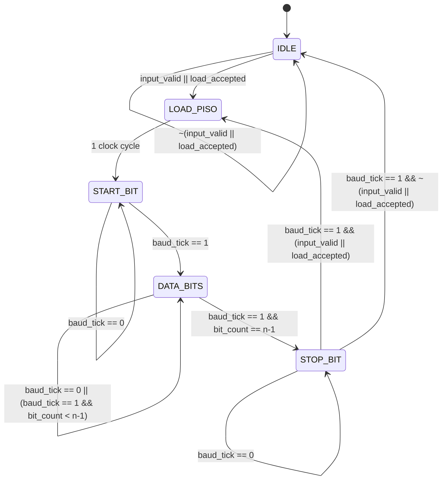

# Implementation of Communication Protocols using Verilog

A modular, hardware-synthesizable implementation of digital communication protocols in Verilog HDL.

---

## Current Implementation: Serial Transmitter (UART Architecture with FSM)

The repository features a fully parameterizable, hardware-synthesizable **UART Serial Transmitter** engineered with a synchronized double-buffered pipeline and a dedicated finite state machine (FSM). The design cleanly decouples host buffer writes from serial transmission, provides hardware handshaking (`tx_ready`, `tx_busy`, `tx_done`), and supports seamless back-to-back transmission.

---

## Architecture Overview

The transmitter employs a modular, structural architecture separating data buffering, serialization, baud generation, and state flow control:

```
                                      +----------------------------------------------------+
                                      |                    transmitter                     |
                                      |                                                    |
data_frame [n-1:0] ------------------>|   +-------------------+                            |
                                      |   |  input_register   |                            |
load -------------------------------->|   |   (register.v)    |                            |
                                      |   +---------+---------+                            |
                                      |             | out[n-1:0]                           |
                                      |             v                                      |
                                      |   +-------------------+                            |
                                      |   |    stream pack    |                            |
                                      |   +---------+---------+                            |
                                      |             | stream[n+1:0]                        |
                                      |             v                                      |
                                      |   +-------------------+                            |
                                      |   |  output_register  |                            |
                                      |   | (parallel_to_     |                            |
                                      |   |     serial.v)     |----+                       |
                                      |   +-------------------+    |                       |
                                      |                            | piso_out              |
                                      |   +-------------------+    v                       |
                                      |   |    counter.v      |   [MUX] ------------------>| transmitted_signal
                                      |   |  (Baud Generator) |    ^                       |
                                      |   +---------+---------+    |                       |
                                      |             | baud_tick    | (UART_EN_N | tx_idle) |
                                      |             v              |                       |
                                      |   +-------------------+    |                       |
clk, rst, UART_EN_N ----------------->|   |  transmitter_fsm  |----+                       |
                                      |   | (Flow Control)    |--------------------------->| tx_ready
                                      |   +-------------------+--------------------------->| tx_busy
                                      |                                                    | tx_done
                                      +----------------------------------------------------+
```

---

## Frame & Protocol Specification

* **Default Data Width ($n$):** 8 bits (parameterized via `#(.n(8))`)
* **Total Frame Width ($n+2$):** 10 bits (`[9:0]`)
* **Transmission Order:** **LSB to MSB**
* **Start Bit:** Active-Low (`1'b0`)
* **Stop Bit:** Active-High (`1'b1`)
* **Idle State:** Line held High (`1'b1`)

### Stream Composition
The composite frame packed for serialization:
$$\text{stream}[n+1:0] = \{\text{stop\_bit},\, \text{out}[n-1:0],\, \text{start\_bit}\}$$

| Frame Index | Signal Bit | Role | Transmission Timing |
| :---: | :---: | :---: | :---: |
| `stream[0]` | `start_bit` | Start Bit (`0`) | 1 Baud Period (`START_BIT`) |
| `stream[1]` | `out[0]` | Data Bit 0 (LSB) | 1 Baud Period (`DATA_BITS`, Bit 0) |
| `stream[2]` | `out[1]` | Data Bit 1 | 1 Baud Period (`DATA_BITS`, Bit 1) |
| ... | ... | ... | ... |
| `stream[n]` | `out[n-1]` | Data Bit $n-1$ (MSB) | 1 Baud Period (`DATA_BITS`, Bit $n-1$) |
| `stream[n+1]` | `stop_bit` | Stop Bit (`1`) | 1 Baud Period (`STOP_BIT`) |
| Idle Line | `1'b1` | Idle Line | Held High (`IDLE` / `LOAD_PISO`) |

---

## Finite State Machine (FSM) Flow Control

The transmitter FSM (`transmitter_fsm.v`) orchestrates all control signals, ensuring full synchronization between buffer loading, shift register loading, baud timing, and external handshake flags.

### State Transition Diagram



### Double-Buffering & Decoupled Handshaking

1. **Independent Loading:**
   * When the host asserts `load` and `tx_ready = 1`, data is captured into `input_register` and `input_valid` is set to `1`.
   * The shift register (`parallel_to_serial`) and active transmission are **not affected**.
2. **Safe Mid-Transmission Queueing:**
   * While a frame is actively shifting out, the host can write the next byte into `input_register`.
   * `tx_ready` drops to `0`, signaling the input holding buffer is full.
   * The FSM holds the new byte in `input_register` and will not load it into `parallel_to_serial` until the previous transmission's stop bit completes.
3. **Seamless Back-to-Back Transmission:**
   * When the stop bit finishes, if a new byte is pending (`input_valid == 1`), the FSM immediately transitions to `LOAD_PISO` and begins the next frame without dead cycles on the wire.
4. **Guaranteed Idle Polarity:**
   * In `IDLE` and `LOAD_PISO`, `transmitted_signal` is unconditionally driven to `1'b1`, preventing any false start bits or framing glitches on reset deassertion.

---

## Module Hierarchy & Description

### 1. `transmitter.v` (Top-Level Module)
Coordinates the transmission pipeline:
* Instantiates `transmitter_fsm`, `register`, `parallel_to_serial`, and `counter`.
* Connects data holding, stream packing, and serial shift stages.
* Provides top-level status ports: `tx_ready`, `tx_busy`, and `tx_done`.

### 2. `transmitter_fsm.v` (FSM Controller)
* Coordinates state sequencing across `IDLE`, `LOAD_PISO`, `START_BIT`, `DATA_BITS`, and `STOP_BIT`.
* Manages `input_valid` status and generates `load_piso`, `piso_shift`, `baud_rst`, `baud_en`, and `tx_idle`.

### 3. `counter.v` (Baud Rate Timing Generator)
* Parameterized modulo-`MAX_COUNT` divider (`MAX_COUNT = CLK_FREQ / BAUD_RATE`).
* Generates a single-clock-cycle pulse `baud_tick` at each baud interval.

### 4. `register.v` (Input Holding Buffer)
* Parameterized $n$-bit synchronous holding register with recirculating enable logic.
* Decouples the host data bus from serial transmission timing.

### 5. `parallel_to_serial.v` (PISO Serializer)
* Parameterized $(n+2)$-stage shift register using `mux_2_1` and `D_ff`.
* Supports parallel load (`select = 0`) and serial shift downward (`select = 1`) with idle padding `1'b1` at the MSB stage.

### 6. `mux_2_1.v` (Multiplexer)
* 2-to-1 multiplexer primitive (`assign out = select ? b : a;`).

### 7. `D_ff.v` (Flip-Flop)
* D flip-flop primitive with synchronous active-high reset (`rst`).

### 8. `testbench.v` (Verification Test Suite)
* Self-checking testbench written for Icarus Verilog (`iverilog`).
* Tests single-byte transmission, back-to-back queueing, handshakes, and VCD waveform output.

---

## Simulation & Verification

To compile and execute the test suite with **Icarus Verilog**:

```bash
iverilog -o sim.out testbench.v transmitter.v transmitter_fsm.v register.v parallel_to_serial.v counter.v D_ff.v mux_2_1.v
vvp sim.out
```

To view waveforms:
```bash
gtkwave waveform.vcd
```

---

## Planned Enhancements

* [x] **Baud Rate Generator:** Configurable clock divider for standard baud rates.
* [x] **Transmitter FSM & Double-Buffering:** Fully synchronized state control and back-to-back transmission.
* [ ] **UART Receiver (RX):** Asynchronous oversampling receiver (16x clock) with start bit detection and majority voting.
* [ ] **Parity Support:** Configurable even/odd/none parity generation and checking.
* [ ] **FIFO Buffers:** Multi-byte TX/RX FIFO integration.
* [ ] **Additional Protocols:** SPI (Master/Slave) and I2C controllers.
