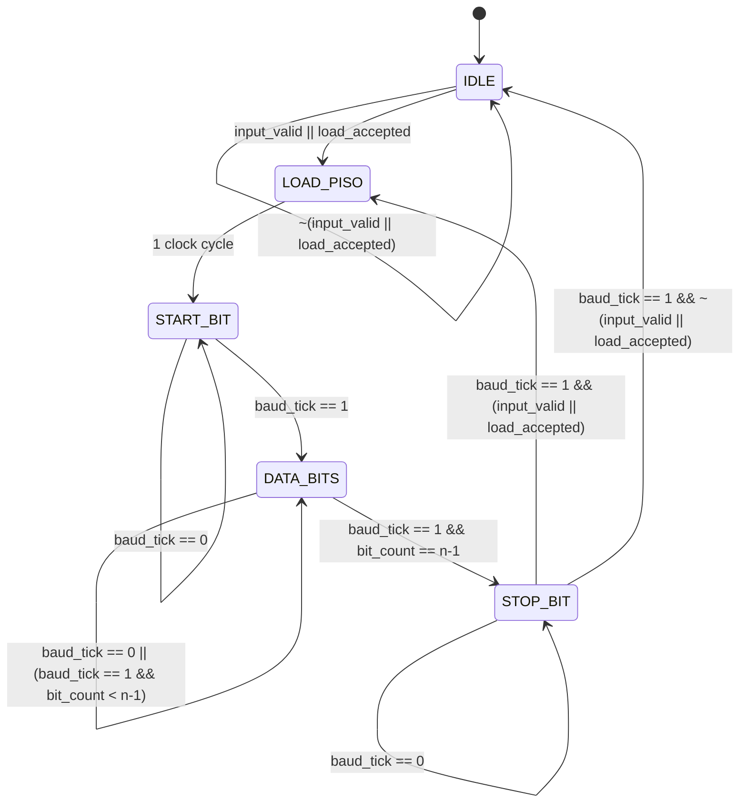
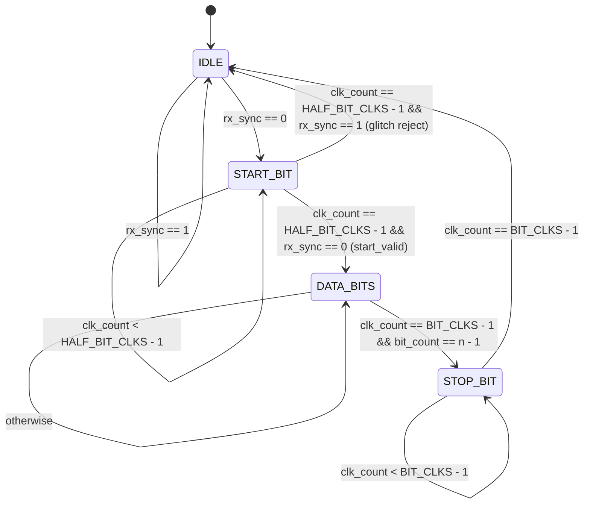

# UART Communication Protocol (Full-Duplex Architecture)

A modular, hardware-synthesizable implementation of a universal asynchronous receiver-transmitter (UART) core in Verilog HDL. The core features a synchronized double-buffered transmitter (TX) and a midpoint-oversampling receiver (RX) with glitch rejection and framing error detection.

---

## Directory Structure

```
UART/
├── README.md                      # Detailed UART architecture documentation
├── counter.v                      # Parameterized modulo counter (baud generator)
├── register.v                     # Parameterized n-bit holding register (mux + D_ff)
├── D_ff.v                         # Synchronous active-high reset D flip-flop
├── mux_2_1.v                      # 2-to-1 multiplexer primitive
├── testbench.v                    # Transmitter self-checking testbench
├── testbench_receiver.v           # End-to-end loopback & receiver testbench
├── transmitter/
│   ├── transmitter.v              # Transmitter top-level module
│   ├── transmitter_fsm.v          # Transmitter finite state machine
│   └── parallel_to_serial.v       # Parameterized PISO shift register
└── receiver/
    ├── receiver.v                 # Receiver top-level module
    ├── receiver_fsm.v             # Receiver finite state machine (oversampling control)
    └── serial_to_parallel.v       # Parameterized SIPO shift register
```

---

## End-to-End System Architecture

The following diagram illustrates the complete dataflow from the host transmitting parallel data, across the physical serial link, to the receiver reconstructing the parallel byte:

```
+----------------------------------------------------------------------------------------------------------------------+
|                                                    TRANSMITTER                                                       |
|                                                                                                                      |
| data_frame[n-1:0] ---> [ input_register ] ---> [ stream pack ] ---> [ parallel_to_serial ]                          |
| load              ---> (register.v)           {1'b1,out,1'b0}       (parallel_to_serial.v)                           |
|                                                                             |                                        |
|                             +-----------------------------------------------+                                        |
|                             |                                                                                        |
|                             v                                                                                        |
|                     [ TX Mux / Buffer ] ----------------------------+                                                |
|                                                                     |                                                |
+---------------------------------------------------------------------|------------------------------------------------+
                                                                      |
                                                          transmitted_signal / rx
                                                                      |
+---------------------------------------------------------------------|------------------------------------------------+
|                                     RECEIVER                        v                                                |
|                                                          +--------------------+                                      |
|                                                          | 2-Stage Sync (DFF) |                                      |
|                                                          +---------+----------+                                      |
|                                                                    | rx_sync                                         |
|                                                                    v                                                 |
| received_signal[n-1:0] <--- [ output_register ] <--- [ serial_to_parallel ] <------------------+                    |
| rx_valid               <---   (register.v)             (serial_to_parallel.v)                  |                    |
|                                     ^                                                          | sipo_enable         |
|                                     | load_out                                                 |                     |
|                           +---------+----------------------------------------------------------+                     |
|                           |                             receiver_fsm                                                 |
|                           +------------------------------------------------------------------------------------------+
+----------------------------------------------------------------------------------------------------------------------+
```

---

## End-to-End Step-by-Step Working

When transferring a byte (e.g., `0xA5 = 8'b10100101` with $n=8$):

```
Time:     Idle  | Start |  D0  |  D1  |  D2  |  D3  |  D4  |  D5  |  D6  |  D7  | Stop | Idle
TX Line:  11111 | 00000 | 1111 | 0000 | 1111 | 0000 | 0000 | 1111 | 0000 | 1111 | 1111 | 1111
RX Sample:      |   ^   |  ^   |  ^   |  ^   |  ^   |  ^   |  ^   |  ^   |  ^   |  ^   |
                | 0.5T  | 1.5T | 2.5T | 3.5T | 4.5T | 5.5T | 6.5T | 7.5T | 8.5T | 9.5T |
```

1. **Idle State:** The serial line is continuously pulled high (`1'b1`).
2. **Transmission Initiation:** The host supplies `data_frame` and asserts `load`. The transmitter loads `input_register`, packages `{1'b1, data_frame, 1'b0}`, and shifts it into `parallel_to_serial`.
3. **Start Bit Detection & Glitch Filtering:**
   * Line transitions from `1` to `0`.
   * The receiver synchronizes `rx` through two flip-flops (`rx_sync1`, `rx_sync`).
   * Receiver enters `START_BIT` and counts $0.5 \times T_{\text{bit}}$ clock cycles (dead-center of the start bit).
   * At midpoint, receiver checks `rx_sync`: if still `0`, `start_valid` asserts and FSM transitions to `DATA_BITS`. If line returned to `1` (noise glitch), FSM resets to `IDLE`.
4. **Data Bit Oversampling & SIPO Reception:**
   * Every full bit interval $T_{\text{bit}}$ ($1.5T, 2.5T, \dots$), the receiver samples the midpoint of each data bit.
   * `sipo_enable` pulses for 1 clock cycle, shifting `rx` into the MSB stage of `serial_to_parallel` and shifting prior bits toward index `0`.
   * After $n$ shifts, bit `0` (LSB) resides at `sipo_out[0]` and bit $n-1$ (MSB) resides at `sipo_out[n-1]`.
5. **Stop Bit Validation & Output Latch:**
   * At the center of the stop bit ($n + 0.5) \times T_{\text{bit}}$, the receiver verifies `rx_sync == 1'b1`.
   * If `1`, `stop_valid` goes high, pulsing `load_out` and `rx_done` / `rx_valid`.
   * The reconstructed byte in `serial_to_parallel` is latched into `output_register`, making `received_signal` stable and available to the downstream system.
   * If the stop bit is `0`, `rx_error` is asserted to signal a framing error.

---

## Module Ports & Interface Definitions

### Transmitter Ports (`transmitter.v`)

| Port Name | Direction | Width | Description |
| :--- | :---: | :---: | :--- |
| `clk` | Input | 1 | System clock. |
| `rst` | Input | 1 | Synchronous active-high reset. |
| `UART_EN_N` | Input | 1 | Active-low UART subsystem enable. |
| `load` | Input | 1 | Host write strobe to queue a new byte. |
| `data_frame` | Input | `n` | Parallel input data word to transmit (default: 8 bits). |
| `transmitted_signal` | Output | 1 | Serial output line to the physical channel. |
| `tx_ready` | Output | 1 | High when input holding register can accept a new byte. |
| `tx_busy` | Output | 1 | High whenever the transmitter is actively transmitting. |
| `tx_done` | Output | 1 | Single-cycle strobe asserting on completion of a frame's stop bit. |

### Receiver Ports (`receiver.v`)

| Port Name | Direction | Width | Description |
| :--- | :---: | :---: | :--- |
| `clk` | Input | 1 | System clock. |
| `rst` | Input | 1 | Synchronous active-high reset. |
| `UART_EN_N` | Input | 1 | Active-low UART subsystem enable. |
| `rx` | Input | 1 | Asynchronous serial input line from physical channel. |
| `received_signal` | Output | `n` | Parallel output data word received (default: 8 bits). |
| `rx_valid` | Output | 1 | Strobe asserting when a valid byte has been received and latched. |
| `rx_busy` | Output | 1 | High whenever receiver is actively capturing a frame. |
| `rx_done` | Output | 1 | Single-cycle pulse upon successful stop bit validation. |
| `rx_error` | Output | 1 | Framing error flag, asserted if stop bit evaluates to `0`. |

---

## Finite State Machines (FSM)

### 1. Transmitter FSM (`transmitter_fsm.v`)

Controls buffering, parallel-to-serial loading, serialization cadence, and idle line driving.



#### States:
* `IDLE (3'd0)`: Line held high (`1'b1`). Waits for host data write.
* `LOAD_PISO (3'd1)`: Latches composite frame `{1'b1, out, 1'b0}` into PISO shift register in 1 clock cycle.
* `START_BIT (3'd2)`: Transmits start bit (`1'b0`) for 1 baud period.
* `DATA_BITS (3'd3)`: Shifts out data bits $0$ to $n-1$ on each `baud_tick`.
* `STOP_BIT (3'd4)`: Drives stop bit (`1'b1`) for 1 baud period; transitions directly to `LOAD_PISO` if back-to-back byte is pending, else returns to `IDLE`.

---

### 2. Receiver FSM (`receiver_fsm.v`)

Controls oversampling timing, midpoint sample alignment, deserialization enable, and error detection.



#### States:
* `IDLE (2'd0)`: Monitors `rx_sync`. Transitions to `START_BIT` the moment `rx_sync` drops low (`1'b0`).
* `START_BIT (2'd1)`: Counts up to $0.5 \times T_{\text{bit}}$ (`HALF_BIT_CLKS - 1`). If `rx_sync == 0` at midpoint, asserts `start_valid` and advances to `DATA_BITS`. If `rx_sync == 1`, discards as a noise glitch and returns to `IDLE`.
* `DATA_BITS (2'd2)`: Counts full bit periods (`BIT_CLKS - 1`). At each bit midpoint, asserts `sipo_enable` to shift the bit into `serial_to_parallel` and increments `bit_count`. When `bit_count == n - 1`, advances to `STOP_BIT`.
* `STOP_BIT (2'd3)`: Counts full bit period to the stop bit midpoint. If `rx_sync == 1`, asserts `stop_valid`, `load_out`, and `rx_done`. If `rx_sync == 0`, flags `rx_error`. Returns to `IDLE`.

---

## Important Control Signals & Logic

### Transmitter Control Signals

| Signal | Type | Logic / Equation | Description |
| :--- | :---: | :--- | :--- |
| `load_accepted` | Wire | `load && tx_ready` | Qualifies a host write only when holding register is ready. |
| `input_valid` | Reg | Set on `load_accepted`, cleared on `load_piso` | Tracks whether unshifted data is waiting in `input_register`. |
| `tx_ready` | Wire | `~input_valid \|\| (state == LOAD_PISO)` | Flow control: high when buffer can accept another byte. |
| `tx_busy` | Wire | `(state != IDLE)` | Indicates transmission is currently active. |
| `tx_done` | Wire | `(state == STOP_BIT) && baud_tick` | 1-cycle pulse at completion of transmission. |
| `load_piso` | Wire | `(state == LOAD_PISO)` | Parallel load enable for PISO shift register. |
| `piso_shift` | Wire | `((state == START_BIT) \|\| (state == DATA_BITS)) && baud_tick` | Serial right-shift trigger for PISO. |
| `baud_rst` | Wire | `(state == IDLE) \|\| (state == LOAD_PISO)` | Synchronous reset for baud counter during inactivity. |
| `baud_en` | Wire | `~baud_rst` | Enables baud counter during active transmission. |

### Receiver Control Signals

| Signal | Type | Logic / Equation | Description |
| :--- | :---: | :--- | :--- |
| `rx_sync1`, `rx_sync` | Reg | 2 flip-flops in series clocked by `clk` | 2-stage synchronizer to prevent metastability. |
| `clk_count` | Reg | Modulo-`BIT_CLKS` counter | Measures clock cycles within bit duration to find midpoint. |
| `start_valid` | Wire | `(state == START_BIT) && (clk_count == HALF_BIT_CLKS - 1) && (!rx_sync) && (bit_count == 4'd0)` | Asserts when start bit is verified at midpoint. |
| `stop_valid` | Wire | `(state == STOP_BIT) && (clk_count == BIT_CLKS - 1) && (rx_sync) && (bit_count == n - 1)` | Asserts when stop bit is verified high at midpoint. |
| `sipo_enable` | Wire | `(state == DATA_BITS) && (clk_count == BIT_CLKS - 1)` | 1-cycle strobe enabling SIPO right shift on data samples. |
| `load_out` | Wire | `stop_valid` | Latches SIPO register into `output_register`. |
| `rx_done` | Wire | `stop_valid` | Pulses high to notify downstream system of a valid byte. |
| `rx_busy` | Wire | `(state != IDLE)` | High while receiving or evaluating a frame. |
| `rx_error` | Wire | `(state == STOP_BIT) && (clk_count == BIT_CLKS - 1) && (!rx_sync)` | Flags framing error when stop bit is not high. |

---

## Simulation & Verification

Both testbenches are self-checking and written for **Icarus Verilog (`iverilog`)**.

### 1. Running the Full Receiver & Loopback Testbench
Connects transmitter output directly to receiver input, verifies single-byte, back-to-back queueing, glitch rejection, and framing errors:

```bash
cd UART
iverilog -o sim_rx testbench_receiver.v receiver/receiver.v receiver/receiver_fsm.v receiver/serial_to_parallel.v transmitter/transmitter.v transmitter/transmitter_fsm.v transmitter/parallel_to_serial.v register.v counter.v D_ff.v mux_2_1.v
vvp sim_rx
```

### 2. Running the Transmitter Testbench
Verifies serialization timing, handshakes, and back-to-back queueing:

```bash
cd UART
iverilog -o sim_tx testbench.v transmitter/transmitter.v transmitter/transmitter_fsm.v transmitter/parallel_to_serial.v register.v counter.v D_ff.v mux_2_1.v
vvp sim_tx
```

### 3. Viewing Waveforms
Waveforms are dumped in standard VCD format:
```bash
gtkwave waveform_receiver.vcd
```
